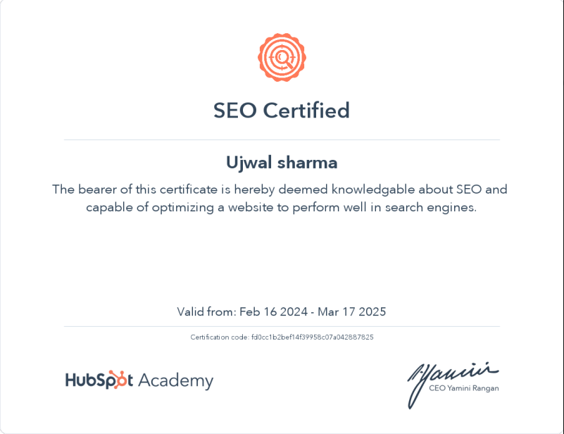
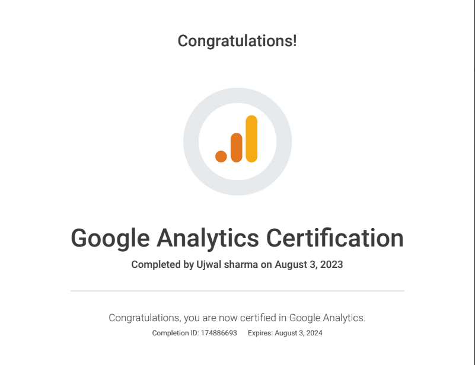
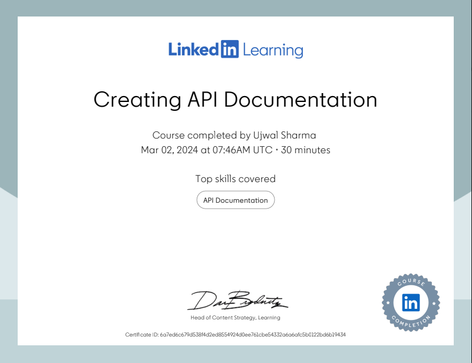
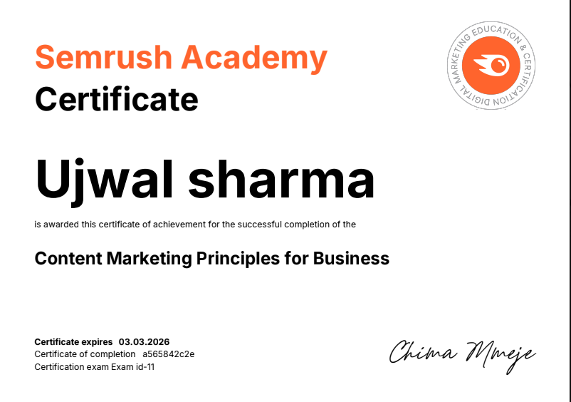
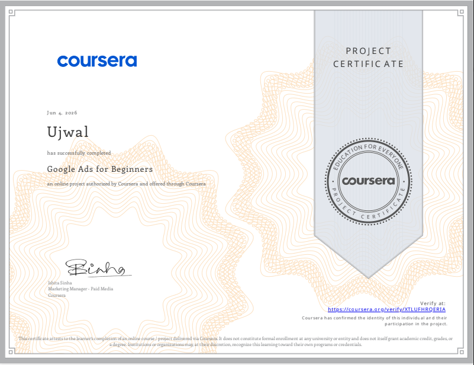
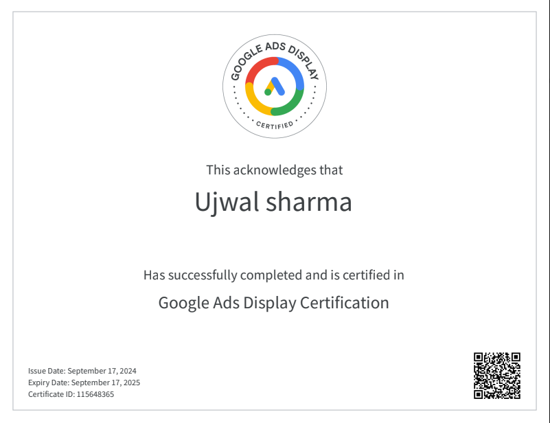

## Hi, I'm Ujwal Sharma, Hope you are doing great 👋

📧 Email: spectrolink@gmail.com   

---

# Experience

### **VeeFly Global Tech** | Software Developer - 1  
*April 2025 – September 2026*  

- Developed and maintained responsive web applications, ensuring scalability and SEO performance.
- Automated workflows and processes to improve efficiency and reduce manual effort.
- Collaborated with product teams to create and refine product requirement documentation, aligning technical solutions with business goals.
- Designed and deployed landing pages to support marketing campaigns, leveraging Framer for interactive and visually appealing designs.
- Designed A/B testing framework for feature and product testing for vivid users.
- Developed Automation tools and AI Agents for departments for smoother workflow.
- Worked closely with cross-functional teams to deliver user-focused solutions on time and within scope.

---

### **Euphoria Integrated Solutions** | Product Developer  
*Jan 2024 – Feb 2025*  

- Built and managed the company’s entire digital presence, including website development on WordPress and domain management.
- Set up and optimized Google Ads campaigns, implemented Google Analytics and tracking systems to measure performance.
- Authored detailed business requirement documents to guide product development and growth strategies.
- Drove both organic growth (SEO management) and paid growth initiatives, improving visibility and lead generation.
- Managed Meta Business Suite for social media campaigns and audience engagement.
- Conducted data scraping and segmentation to support marketing and product decisions.
- Led a small team of two, overseeing tasks and ensuring project delivery.
- Handled LinkedIn profile management to enhance brand presence and outreach.
- Set up and administered Zoho Workspace for streamlined communication and collaboration.

---

### **Thinklance Ed-Tech** | Marketing (Organic Growth)  
*March 2022 – July 2023*  

- WordPress development of landing pages and the website. Tracked and maintained organic growth performance.
- Produced 3–4 high-quality blogs per week, strategically optimized with keyword research to drive website traffic and improve visibility.
- Conducted content audits and updates of older materials, enhancing engagement and SEO performance through structured revisions.
- Planned and executed social media campaigns, documenting workflows and strategies to boost brand awareness and audience interaction.
- Developed email campaigns and Electronic Direct Mail (EDM) strategies, achieving higher click-through rates and effectively reaching targeted audiences.
- Conducted thorough research, editing, and proofreading to ensure accuracy, clarity, and readability across technical and marketing content.
- Created structured online class modules, improving learner experience, retention, and accessibility through clear instructional design.
- Applied SEO techniques and strategies to optimize blogs and digital content, ensuring alignment with search engine best practices.
- Utilized tools such as SEMrush, Google Analytics 4, and Ahrefs for keyword research, performance tracking, and data-driven content decisions.

---

### **Cashify** | Content Moderator  
*August 2023 – December 2023* *(Temporary Work: August – October)*  

- Written (UI/UX) and updated product pages (Technical).
- Performed SEO writing for long-tail keywords. Optimized old pages, conducted SEO audits, and handled technical SEO.
- Worked on WordPress CMS as a contributor.

---

# 🎓 Education

- **B.Sc in Mathematics, Physics & Electronics** | *Graduated 2020* – Hislop College, RTMNU University, Nagpur (First Division, 62%) 

---

# 🛠️ Technical Skills

- **Languages:** JavaScript, Python, HTML, CSS  
- **Frameworks & Library:** Frontend (Vue.js, Next.js, Tailwind & React) | Backend (Express.js)  
- **CMS:** WordPress, Framer, Shopify, HubSpot, Wix  
- **Analytics:** GA4, Google Search Console, Microsoft Clarity, Metabase, Clickhouse  
- **Deploys:** GitHub Actions, Docker  
- **Marketing & SEO Tech:** SEMrush, Ahrefs, Sendy, Mautic, Meta Business Suite, Zoho Workspace  
- **Platforms:** Google Cloud Console, GitHub, Git, Docker Desktop, Coolify, Unleash  
- **Documentation:** Technical Docs, PRD, BRD, User Guides, Whitepapers, Knowledge Bases, Schema Design (JSON-LD, XML)  
- **Additional:** Jira, Notion, GitBook, Terminal, CLI Agents

# 📜 Certifications

<table>
  <tr>
    <td align="center"> SEO Certificate</td>
    <td align="center"> Google Analytics 4</td>
    <td align="center"> Creating API Documentation</td>
  </tr>
  <tr>
    <td align="center"> Content Marketing Principles</td>
    <td align="center"> Google Ads Beginners</td>
    <td align="center"> Google Ads Display</td>
  </tr>
  <tr>
    <td align="center">Python Beginners (Kaggle)</td>
    <td align="center">Generative AI Skills for Content Creation</td>
    <td>&nbsp;</td>
  </tr>
</table>

✨ *Connect with me to develop Applications, AI automation, Technical Documentation and content engineering to build scalable, user-focused products.*
